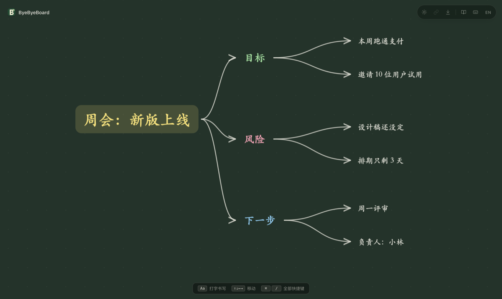
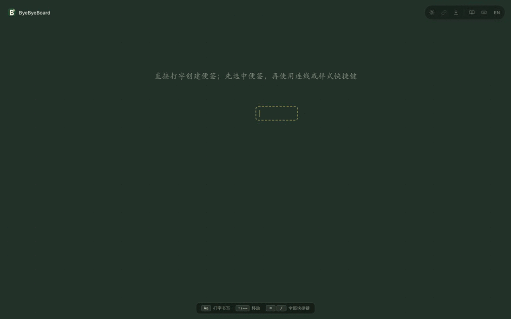

# ByeByeBoard

A keyboard-first online whiteboard.

用键盘整理想法的在线白板：打开画布直接写，`Enter` 接一条同级，`Tab` 长出带连线的子级，再把这些想法拖到合适的位置。没有账号、模板和初始化流程，适合讲课、会议和个人梳理。

[产品介绍](https://byebyeboard.com/) · [打开白板](https://byebyeboard.com/board/) · [中文指南](https://byebyeboard.com/zh/guide.html) · [English guide](https://byebyeboard.com/guide.html)



## 本地运行

需要 Node.js 22.12+ 与 npm。

```sh
npm ci
npm run dev
```

- 白板：http://localhost:3001/board/
- 英文首页：http://localhost:3001/
- 中文首页：http://localhost:3001/zh/

3001 被占用时 Vite 会顺延到下一个端口，以终端输出的地址为准。

```sh
npm run lint    # TypeScript 类型检查
npm test        # 白板模型、键盘与导出的单元测试
npm run build   # 构建到 dist/
npm run preview # 预览构建产物
```

## 怎么用

| 操作 | 快捷键 |
| --- | --- |
| 新建便签，或继续写选中的便签 | 直接输入 |
| 写完，接一条同级便签 | `Enter` |
| 写完，展开子级（自动连线） | `Tab` |
| 返回上一级 | `Shift` + `Tab` |
| 便签内换行 | `Shift` + `Enter` |
| 结束编辑 | `Esc` |
| 跳到该方向最近的便签 | 方向键 |
| 朝该方向延伸一条便签 | `Option`/`Alt` + 方向键 |
| 连线或断开 | `L` 或 `Ctrl`/`⌘` + `Enter` |
| 移动选中的便签 | `Shift` + 方向键 |
| 完整快捷键 | `F1` 或 `Ctrl`/`⌘` + `/` |

鼠标同样可用：拖动便签、平移画布、缩放视图。样式快捷键在帮助面板里：`Alt` + `1–6` 换颜色，`Alt` + `B` 切外框，`Alt` + `+`/`−` 调字号，`Ctrl`/`⌘` + `B` 加粗，`Alt` + `T` 切换黑板/白板，`Ctrl`/`⌘` + `Z` 撤销。支持 6 种颜色、4 档字号和 PNG、JSON 两种导出。



## 数据与边界

便签、连线、样式和主题保存在当前浏览器的 `localStorage`，键为 `byebyeboard.board`、`byebyeboard.theme`，语言单独存放。没有账号、云同步或实时协作；换浏览器、清理站点数据或换域名，白板不会跟过去。

- PNG 用来分享成品。
- JSON 是导出的记录，**当前版本不能导回**，不要把它当作备份。
- 相机位置和撤销历史不持久化。

## 页面与技术

| 路径 | 内容 |
| --- | --- |
| `/`、`/zh/` | 可直接抓取的英文、中文产品介绍 |
| `/board/` | React 白板应用 |
| `/guide.html`、`/zh/guide.html` | 可直接抓取的使用指南 |
| `/robots.txt`、`/sitemap.xml`、`/llms.txt` | 搜索与 AI 检索入口 |

React 19 · TypeScript · Vite 6。构建产物是纯静态文件，由 Nginx 提供并托管在 Fly.io，没有后端、账号体系或 API key。首页和指南不依赖 JavaScript，未知路径返回 404，`/healthz` 供部署检查。页面只用本机字体，不请求外部字体服务。

```
src/components/whiteboard/  工具栏、提示条与快捷键面板
src/lib/whiteboard/         白板模型、本地存储、PNG/JSON 导出
src/lib/                    键盘映射与中英文案
src/pages/                  白板页面与样式
public/                     首页样式、指南、robots/sitemap/llms
board/                      白板入口
```

部署、域名与证书设置见 [docs/standalone.md](docs/standalone.md)。

## Author

© 2026 ByeByeBoard · Made by [Gamehu](https://github.com/Gamehu)
